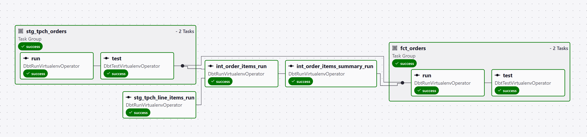
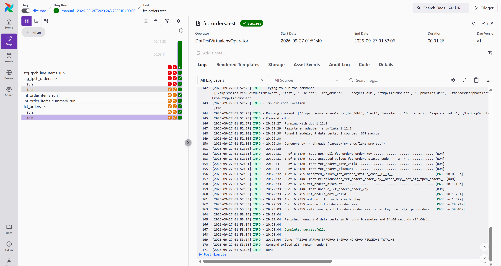
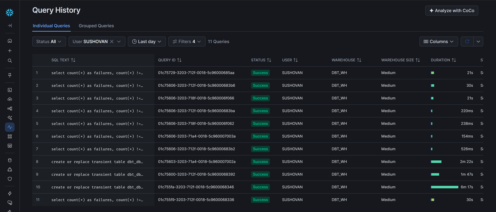

# dbt + Astronomer Cosmos + Snowflake ETL Pipeline

An end-to-end ELT pipeline that uses **Astronomer Cosmos** to orchestrate **dbt** transformations on **Snowflake**, all running inside a local **Airflow** environment powered by the **Astro CLI**.

The pipeline reads from Snowflake's built-in TPC-H sample data (`SNOWFLAKE_SAMPLE_DATA.TPCH_SF1000`), transforms it through a layered dbt model structure (staging → intermediate → marts), and materializes a final `fct_orders` fact table in Snowflake — scheduled daily via Airflow.

---

## Tech Stack

| Layer | Tool |
|---|---|
| Orchestration | Apache Airflow (via Astro Runtime 3.3) |
| dbt Integration | Astronomer Cosmos |
| Transformation | dbt-core + dbt-snowflake |
| Data Warehouse | Snowflake |
| Auth | RSA key-pair authentication (PEM) |
| Containerization | Docker + Docker Compose |
| Package Utility | dbt-utils (surrogate keys) |

---

## What Gets Built

### Snowflake Objects

| Object | Type | Layer | Description |
|---|---|---|---|
| `stg_tpch_orders` | View | Staging | Cleaned orders from `TPCH_SF1000.orders` |
| `stg_tpch_line_items` | View | Staging | Cleaned line items with surrogate key from `TPCH_SF1000.lineitem` |
| `int_order_items` | Table | Intermediate | Orders joined with line items; applies `discounted_amount` macro |
| `int_order_items_summary` | Table | Intermediate | Per-order aggregation of gross sales and discount amounts |
| `fct_orders` | Table | Mart | Final fact table — orders enriched with sales and discount summaries |

### dbt Tests

- **Generic tests** — `unique`, `not_null`, `relationships`, `accepted_values` on `fct_orders`
- **Singular tests** — `fct_orders_discount` (no positive discounts), `fct_orders_date_valid` (order dates within valid range)
- **Source tests** — `unique`/`not_null` on `orders.o_orderkey`, `relationships` between `lineitem.l_orderkey` → `orders.o_orderkey`

---

## Repository Structure

```
2_dbt_astro_cosmos/
├── dags/
│   ├── dbt_dag.py                          # Airflow DAG — Cosmos DbtDag definition
│   ├── .airflowignore
│   └── dbt/
│       └── my_snowflake_project/           # dbt project root
│           ├── dbt_project.yml             # dbt project configuration
│           ├── packages.yml                # dbt packages (dbt-utils 1.4.1)
│           ├── models/
│           │   ├── staging/
│           │   │   ├── tpch_sources.yml    # Source definitions (TPCH_SF1000)
│           │   │   ├── stg_tpch_orders.sql
│           │   │   └── stg_tpch_line_items.sql
│           │   └── marts/
│           │       ├── int_order_items.sql
│           │       ├── int_order_items_summary.sql
│           │       ├── fct_orders.sql
│           │       └── generic_tests.yml   # Generic tests for fct_orders
│           ├── macros/
│           │   └── pricing.sql             # discounted_amount macro
│           ├── tests/
│           │   ├── fct_orders_discount.sql
│           │   └── fct_orders_date_valid.sql
│           ├── seeds/
│           ├── snapshots/
│           ├── analyses/
│           └── generate_keys.py            # RSA key-pair generator for Snowflake auth
├── keys/                                   # RSA keys mounted into containers (not committed)
├── include/
├── plugins/
├── tests/
├── Dockerfile                              # Astro Runtime 3.3-8 base image
├── requirements.txt                        # Python deps (cosmos, dbt, snowflake provider)
├── docker-compose.override.yml             # Mounts keys/ into scheduler, dag-processor, triggerer
├── airflow_settings.yaml                   # Local Airflow connections (snowflake_conn)
├── .env                                    # Environment variables (key passphrase, DAG settings)
└── packages.txt                            # OS-level packages (if any)
```

---

## How the Pipeline Works

### 1. Airflow picks up the DAG

`dbt_dag.py` defines a `DbtDag` using Cosmos. Cosmos reads the dbt project at `dags/dbt/my_snowflake_project/`, introspects the model graph, and generates an Airflow task per dbt node (model, test, seed, etc.).

### 2. Execution mode: `VIRTUALENV`

Each dbt task runs inside an isolated Python virtualenv created at runtime. The `py_requirements` parameter installs `dbt-core` and `dbt-snowflake` into each virtualenv, keeping the Airflow worker environment clean.

### 3. Snowflake authentication

The DAG uses `SnowflakePrivateKeyFilePemProfileMapping` — Cosmos maps the Airflow connection `snowflake_conn` into a dbt profile, injecting the RSA private key path and passphrase. The key file is mounted into containers via `docker-compose.override.yml`.

### 4. dbt transformation layers

```
Source (SNOWFLAKE_SAMPLE_DATA.TPCH_SF1000)
  │
  ├── orders ─────────► stg_tpch_orders (view)
  │                         │
  └── lineitem ──────► stg_tpch_line_items (view)
                            │
                            ▼
                      int_order_items (table)
                        uses discounted_amount macro
                            │
                            ▼
                      int_order_items_summary (table)
                        aggregates gross sales & discounts per order
                            │
                            ▼
                      fct_orders (table)
                        final fact table enriched with sales metrics
```

### 5. Testing

Cosmos generates Airflow tasks for both generic and singular dbt tests. These run after their upstream models, so a test failure surfaces as a failed Airflow task.

### 6. Schedule

The DAG runs `@daily` with `catchup=False`, starting from `2026-09-26`.

---

## System Design

```
┌──────────────────────────────────────────────────────────┐
│                     Astro CLI (local)                    │
│  ┌────────────────────────────────────────────────────┐  │
│  │               Docker Compose                       │  │
│  │  ┌──────────┐  ┌───────────┐  ┌─────────────────┐ │  │
│  │  │ Scheduler│  │ Webserver │  │  DAG Processor   │ │  │
│  │  └────┬─────┘  └───────────┘  └────────┬────────┘ │  │
│  │       │                                │          │  │
│  │       └──────────┬─────────────────────┘          │  │
│  │                  ▼                                │  │
│  │        ┌──────────────────┐                       │  │
│  │        │  Cosmos DbtDag   │                       │  │
│  │        │  (dbt_dag.py)    │                       │  │
│  │        └────────┬─────────┘                       │  │
│  │                 │ VIRTUALENV execution mode        │  │
│  │                 ▼                                 │  │
│  │        ┌──────────────────┐                       │  │
│  │        │  dbt-core        │                       │  │
│  │        │  dbt-snowflake   │                       │  │
│  │        └────────┬─────────┘                       │  │
│  │                 │ RSA key-pair auth                │  │
│  └─────────────────┼────────────────────────────────┘  │
│                    │                                    │
└────────────────────┼────────────────────────────────────┘
                     │
                     ▼
          ┌─────────────────────┐
          │      Snowflake      │
          │  ┌───────────────┐  │
          │  │ SNOWFLAKE_     │  │
          │  │ SAMPLE_DATA   │  │  ◄─ Source
          │  │ .TPCH_SF1000  │  │
          │  └───────────────┘  │
          │  ┌───────────────┐  │
          │  │ DBT_DB        │  │
          │  │ .DBT_SCHEMA   │  │  ◄─ Target (views + tables)
          │  └───────────────┘  │
          └─────────────────────┘
```

---

## ETL Pipeline Flow

```
┌────────────────┐     ┌────────────────────┐     ┌──────────────────────┐
│   Extract      │     │    Transform       │     │     Load             │
│                │     │                    │     │                      │
│ Snowflake      │────►│ stg_tpch_orders    │────►│ fct_orders (table)   │
│ TPCH_SF1000    │     │ stg_tpch_line_items│     │ in DBT_DB.DBT_SCHEMA │
│ (orders,       │     │ int_order_items    │     │                      │
│  lineitem)     │     │ int_order_items_   │     │ Tested with generic  │
│                │     │   summary          │     │ + singular tests     │
└────────────────┘     └────────────────────┘     └──────────────────────┘
        │                       │                          │
        │              Orchestrated by Cosmos              │
        └──────────── on Airflow (Astro Runtime) ──────────┘
```

---

## Airflow Connections

The project uses a single Airflow connection configured in `airflow_settings.yaml` (local dev only):

| Field | Value |
|---|---|
| `conn_id` | `snowflake_conn` |
| `conn_type` | `snowflake` |
| `conn_login` | *(your Snowflake username)* |
| `conn_schema` | `dbt_schema` |
| `account` | *(your Snowflake account identifier)* |
| `warehouse` | `dbt_wh` |
| `database` | `dbt_db` |
| `role` | `dbt_role` |
| `private_key_file` | `/usr/local/airflow/keys/snowflake_rsa_key.p8` |
| `private_key_file_pwd` | *(set via `.env`)* |

> **Note:** The `docker-compose.override.yml` mounts the local `keys/` directory into the scheduler, dag-processor, and triggerer containers so the RSA key file is available at runtime.

---

## How to Run Locally

### Prerequisites

- [Astro CLI](https://www.astronomer.io/docs/astro/cli/install-cli) installed
- [Docker Desktop](https://www.docker.com/products/docker-desktop/) running
- A Snowflake account with the TPC-H sample data accessible
- An RSA key-pair generated for Snowflake authentication

### Steps

1. **Clone the repository**
   ```bash
   git clone <repo-url>
   cd 2_dbt_astro_cosmos
   ```

2. **Generate RSA keys** (if not already done)
   ```bash
   cd dags/dbt/my_snowflake_project
   python generate_keys.py
   cd ../../..
   ```
   Copy the generated `.p8` key to the `keys/` directory:
   ```bash
   mkdir -p keys
   cp dags/dbt/my_snowflake_project/rsa_key.p8 keys/snowflake_rsa_key.p8
   ```

3. **Configure environment variables**

   Update `.env` with your passphrase:
   ```env
   AIRFLOW__CORE__DAG_DISCOVERY_SAFE_MODE=False
   SNOWFLAKE_PRIVATE_KEY_PASSPHRASE=<your_passphrase>
   ```

4. **Configure the Airflow connection**

   Edit `airflow_settings.yaml` with your Snowflake account details (username, account identifier, passphrase).

5. **Start Airflow**
   ```bash
   astro dev start
   ```

6. **Access the Airflow UI**

   Open [http://localhost:8080](http://localhost:8080) and trigger the `dbt_dag`.

7. **Stop Airflow**
   ```bash
   astro dev stop
   ```

---

## Images

### Airflow dbt DAG


### Airflow successful run


### Snowflake query history


---

## Problems Faced While Building

1. **`profile_args` passed as tuple instead of dict** — should be a dict of key/value pairs
2. **`daabase` typo in `profile_args`** — misspelled `database`, silently ignored by dbt
3. **`dbt_executable_path` pointed at wrong env var** — used `AIRFLOW` instead of the proper dbt binary path
4. **Windows-style backslash path in `ProjectConfig`** — broke on escape characters inside Python strings
5. **Relative path in `ProjectConfig`** — ambiguous resolution (resolved relative to DAGs folder, not repo root)
6. **`ExecutionMode` used but not imported** — `NameError` at DAG parse time
7. **`ProfileConfig(profile_config=...)`** — wrong kwarg name, should be `profile_name`
8. **`VIRTUALENV` execution mode missing `py_requirements`** — virtualenv created without `dbt-core` and `dbt-snowflake`, causing `ModuleNotFoundError`
9. **Empty/blank fields in `airflow_settings.yaml` connection block** — partial connection created, missing critical auth details
10. **Empty `pools`/`variables` blocks in `airflow_settings.yaml`** — caused potential YAML parse issues on some Astro CLI versions
11. **Used `SnowflakeUserPasswordProfileMapping`** — wrong mapping; actually needed `SnowflakePrivateKeyFilePemProfileMapping` for key-pair auth
12. **`target_name` mistakenly set to project name** — should be an actual target label defined in the dbt profile
13. **DAG registered in `dags list` (CLI) but missing from Airflow UI** — DAG file was being skipped during UI discovery
14. **`dags unpause` command ran but `is_paused` stayed `True`** — related to safe-mode discovery issue
15. **Root cause of #13/#14: `dag_discovery_safe_mode=True`** — file skipped because it lacked the literal string `"airflow"` in the source code; fixed by setting `AIRFLOW__CORE__DAG_DISCOVERY_SAFE_MODE=False` in `.env`
16. **Snowflake connection failed — MFA required** — password auth not supported programmatically with MFA-enabled accounts; had to switch to RSA key-pair
17. **`conn_login` missing entirely** — after switching to key-pair setup, the login field was accidentally removed
18. **`conn_login` mistakenly set to account identifier** — should be the actual Snowflake username, not the account locator
19. **Redundant/incorrect `user` field inside `conn_extra`** — `conn_login` already provides the username; extra `user` field caused confusion
20. **`airflow_settings.yaml` changes not reflected in UI** — file only imports once at DB init (`astro dev start`), not on every restart; had to run `astro dev kill` + `astro dev start` to re-import
21. **`private_key_file_pwd` vs `private_key_passphrase` mismatch** — Airflow `conn_extra` uses `private_key_file_pwd`, but `dbt-snowflake` expects `private_key_passphrase`; Cosmos profile mapping bridges the gap via the `profile_args` passphrase field

---

## Doubts Asked

1. **Full path vs relative path for `ProjectConfig`** — resolved by using `Path(__file__).parent / "dbt"` for a reliable absolute path relative to the DAG file
2. **How to give `conn_password` for key-pair auth** — clarified that password field is unused; passphrase goes in `conn_extra` as `private_key_file_pwd` and in `profile_args` as `private_key_passphrase`
3. **Key stored as file on disk vs pasted content** — confirmed the project uses a `.p8` file on disk, mounted into containers via `docker-compose.override.yml`
4. **Is the DAG docstring functionally important for Cosmos/backfills?** — no functional impact, but `dag_discovery_safe_mode` scans for the literal string `"airflow"` in the file
5. **Where to edit `airflow.cfg` in an Astro project** — don't edit `airflow.cfg` directly; use environment variables in `.env` (e.g., `AIRFLOW__CORE__DAG_DISCOVERY_SAFE_MODE=False`)
6. **Where to keep `docker-compose.override.yml` and how to mount volumes** — place at project root; Astro CLI automatically merges it with the base compose file
7. **`docker-compose.override.yml` vs `docker-compose.yml` — which to create** — use `override` to avoid conflicting with Astro CLI's managed `docker-compose.yml`; overrides are merged automatically

---

## Learning Reference

Per Astronomer's runtime docs for Airflow 3.x:

* Astro Runtime 3.0+ is effectively a slim image.
* It only includes the packages needed to run Astro itself.
* Any extra provider/package like `apache-airflow-providers-snowflake` or `astronomer-cosmos` must be added explicitly in your project dependencies, typically in `requirements.txt`.


------
* `astronomer-cosmos` — Cosmos DAG/task integration for dbt
* `apache-airflow-providers-snowflake` — Snowflake hooks/operators for Airflow
* `dbt-core` — dbt engine
* `dbt-snowflake` — dbt adapter for Snowflake

------
### What is the difference between requirement.txt, Dockerfile & docker-compose.yml? Where to keep what? Teach me from first-principle.

I'll explain the three files at the layer they operate in—build-time, runtime, and orchestration—so the distinction is clear and practical.

#### First-principles view

Think of a containerized app as three layers:

1. The base environment
2. The app code and installed libraries
3. How the app is started and connected together

Those map roughly to:

- `Dockerfile` → how the image is built
- `requirements.txt` → Python packages to install inside the image
- docker-compose.yml → how the containers are run together

---

#### 1) `requirements.txt`

This is a Python package manifest.

##### Purpose
It tells pip:
- which Python libraries to install
- which versions to install
- in what environment

Example:

```txt
astronomer-cosmos
apache-airflow-providers-snowflake
dbt-core
dbt-snowflake
```

##### What it does
When you run something like:

```bash
pip install -r requirements.txt
```

pip installs those packages into the Python environment.

##### Where it belongs
- In a Python project
- Usually at the project root
- Used by Docker build or by local dev environment

##### Important idea
This file does not start services.
It does not define containers.
It only declares Python dependencies.

---

#### 2) `Dockerfile`

This is the image blueprint.

##### Purpose
It tells Docker:
- what base image to start from
- what system packages to install
- what app files to copy
- what commands to run during build

Example:

```dockerfile
FROM astrocrpublic.azurecr.io/runtime:3.3-8
```

A fuller example might be:

```dockerfile
FROM astrocrpublic.azurecr.io/runtime:3.3-8

COPY requirements.txt /tmp/requirements.txt
RUN pip install --no-cache-dir -r /tmp/requirements.txt

COPY . /usr/local/airflow
```

##### What it does
Docker reads the Dockerfile and creates an image.

The image is a snapshot of:
- OS
- Python
- installed packages
- app files
- configuration

##### Where it belongs
- At the project root as `Dockerfile`
- Usually one per project

##### Important idea
The Dockerfile answers:
- "What should my container look like?"

Not:
- "How do I run multiple containers?"
- "How do I connect services?"

---

#### 3) docker-compose.yml

This is the runtime orchestration file.

##### Purpose
It tells Docker Compose:
- which containers to start
- their ports
- environment variables
- volumes
- dependencies between services
- how they connect

Example:

```yaml
version: "3.8"

services:
  airflow:
    build: .
    ports:
      - "8080:8080"
    environment:
      AIRFLOW__CORE__LOAD_EXAMPLES: "false"
```

##### What it does
Compose reads this file and starts containers together.

It can manage:
- app container
- postgres
- redis
- any supporting services

##### Where it belongs
- project root as `docker-compose.yml`
- used for local development and multi-service setups

##### Important idea
Compose answers:
- "How do I run this system?"

Not:
- "What packages should be installed?"
- "What base image should be built?"

---

#### Mental model

Think of it like building a house:

- `requirements.txt` = list of materials and tools for the Python app
- `Dockerfile` = blueprint of the building itself
- docker-compose.yml = the site plan showing how multiple buildings and services are started together

---

#### In Astro specifically

For Astro projects, the common pattern is:

- `Dockerfile`: base runtime image + maybe extra setup
- `requirements.txt`: Python packages like `dbt-snowflake`, `astronomer-cosmos`, `apache-airflow-providers-snowflake`
- docker-compose.yml: often not needed for normal Astro deployments; Astro CLI handles local orchestration

So in your current project:

- `requirements.txt` is where you keep Python packages
- `Dockerfile` is where you pin the runtime base image and any image-level setup
- docker-compose.yml is only for multi-container orchestration, not for normal package installation

---

#### Rule of thumb

Use each file for one job:

- Put Python libraries in `requirements.txt`
- Put image build instructions in `Dockerfile`
- Put service orchestration in docker-compose.yml

---

#### Your project example

For dbt + Snowflake + Cosmos on Astro, the usual setup is:

- `requirements.txt`:
  ```txt
  astronomer-cosmos
  apache-airflow-providers-snowflake
  dbt-core
  dbt-snowflake
  ```

- `Dockerfile`:
  ```dockerfile
  FROM astrocrpublic.azurecr.io/runtime:3.3-8
  ```

No need to put those packages in the Dockerfile unless you are doing a custom install step. For Astro, `requirements.txt` is the standard place.

---

#### One-sentence summary

- `requirements.txt`: install Python packages
- `Dockerfile`: build the container image
- docker-compose.yml: run the services together

If you want, I can also show you the exact folder layout for a clean Astro + dbt + Snowflake project and explain why each file is placed there.

--------